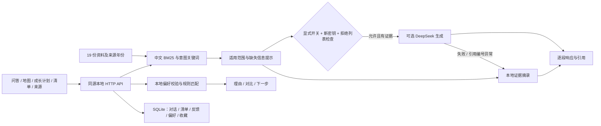

# 架构与接口

## 默认运行链路

浏览器同源 HTML/CSS/JavaScript → Python 标准库 HTTP 服务 → BM25 检索与元数据校验 → 本地资料摘录 → SSE 响应 → SQLite 保存。默认不下载 embedding，不建立 Chroma 依赖，也不发出模型请求。



可选在线生成仅验证了模拟成功/失败边界；未做真实收费调用。正文引用编号校验只能检查格式，不能保证模型事实逐项正确。

每条回答保存remote_attempted，记录该次是否尝试外部模型请求。外部失败后回退的本地回答会展示提醒，不能将“本地回答”推断为“没有外部请求”。

## 数据结构

文本块有稳定内容哈希 id、文件来源、章节、原文、文档头、来源链接、适用参考年份、采集日期、来源类型、是否核对与适用范围提示。文档头不会因按章节切分而丢失。

四种来源标记：官方入口已核对、交接资料待核对、第三方参考、交接地图参考。官网入口核对不等于已核对整篇原始迎新政策。来源文件集合由固定清单指定，接手材料、环境文件、会话记录不会进入检索库。

清单只保存“会话、任务id、是否勾选”。不要求输入姓名、证件号码、手机号或银行卡信息。会话标识在本地浏览器随机生成；同浏览器多标签共享记录。

## 接口

全部路径在同一服务端口。JSON 响应使用 UTF-8。修改接口需 `Content-Type: application/json`，跨站 Origin 被拒绝。

| 方法与路径 | 请求/参数 | 返回 |
|---|---|---|
| GET /api/health | 无 | status、版本、资料数、模式、模型请求计数 |
| GET /api/stats | 无 | 知识库与模式统计 |
| GET /api/catalog | 无 | FAQ、地点、路线和清单定义 |
| GET /api/places | 无 | 地点列表 |
| GET /api/sources | 无 | 来源、年份、适用范围与章节原文 |
| GET /api/history | session | 最近60条会话消息 |
| POST /api/ask | session、question | SSE：status、sources、delta、done |
| GET /api/checklist | session | 任务勾选状态 |
| POST /api/checklist | session、task、checked | 保存后的状态 |
| POST /api/feedback | session、answer、value | saved；value为helpful/unhelpful |
| GET /api/export | session | 最近100条消息、清单、偏好与收藏计划 |
| GET /api/explore | 无 | 稳定id的统一目录、兴趣与专业方向选项 |
| GET /api/dorm /api/contest /api/club /api/studentorg | 无 | 作者四个参考模块的数据 |
| GET /api/profile | session | 当前偏好，首次为空 |
| POST /api/profile | session、profile | 保存偏好并返回推荐 |
| POST /api/recommend | session、profile | 校验后返回推荐，不写偏好 |
| GET /api/saved | session | 当前收藏、状态、下一步建议 |
| POST /api/saved | session、item、status | 根据服务端id保存或移除，最多30项 |
| DELETE /api/history | session | deleted；保留清单 |

提问示例，服务已启动时运行：

```python
import json
from urllib.request import Request, urlopen

request = Request(
    "http://127.0.0.1:8765/api/ask",
    data=json.dumps({"session": "example-session-001", "question": "报到要带什么材料？"}).encode(),
    headers={"Content-Type": "application/json"},
    method="POST",
)
with urlopen(request) as response:
    print(response.read().decode("utf-8"))
```

输入限制：问题1–500字，JSON请求不超过16KB，会话标识16–64个字母/数字/下划线/连字符。每个回环客户端每分钟最多30次提问。

错误：400表示参数不合法，403表示Host/Origin不受支持，404表示资源不存在，429表示频率限制，500返回通用可重试提示。不会把供应商异常细节或密钥回显到页面。

## 本地部署边界

仅绑定127.0.0.1，静态文件白名单，CSP禁止外部脚本及页面嵌入；用户文本和来源通过DOM textContent呈现。SQLite连接在每次操作后关闭，避免Windows文件占用。

此版本不承担公网账户认证、访问授权、生产备份或学校业务系统代办。需要公网部署时，应另行设计身份认证、访问隔离、TLS与运维；本轮没有上传、公开发布或推送远程仓库。

## 推荐与计划边界

profile字段：interests为固定id数组；college为目录中完整方向名称或空；hours为low/medium/high；room为siren/liuren；priorities为quiet/light/access/dry，每项严格为0–3整数，不接受布尔值。缺失权重默认1。

床位按sum(权重×图上位置参考值)排序，同分并列。其他选项按兴趣关键词命中计算3+min(命中数,3)，匹配指定专业方向的竞赛另加8；不匹配专业的专用竞赛不列入推荐。课外时间仅改变提醒，不虚构每个社团所需小时。每类最多展示6项。没有兴趣匹配就显示空结果；推荐路径不接触模型适配器。

收藏只接受服务端目录id。status为planned/doing/done/removed；removed移除偏好收藏。执行状态是用户自记，done表示完成了解，不表示报名、入选或完成赛事。最多30项在SQLite事务内校验。比较列表仅为当前页面临时状态，同类最多3项。跨浏览器不同会话不会共享个人记录。


## 1.2.0 日程与任务接口

个人任务存在personal_tasks(id,session,payload)表，按会话隔离，最多100项（含归档）。首次运行自动建表，保留原有数据。没有计划的记录保持空日期，正式日期不会从资料或搜索结果推断。

| 方法与路径 | 用途 |
|---|---|
| GET /api/tasks?session=... | 当前会话的全部任务 |
| POST /api/tasks | 新建或更新task对象；更新必须给本会话已存在的id |
| POST /api/tasks/from-choice | item必须已收藏，按来源和建议序号合并3项下一步 |
| GET /api/tasks/backup?session=... | JSON任务备份，format=freshman-guide-tasks，format_version=1 |
| POST /api/tasks/import-preview | 校验backup，计算新增/跳过数和前5个标题，不写数据库 |
| POST /api/tasks/import | 再次校验并事务合并；不覆盖现有数据，超限不写入任何任务 |
| GET /api/tasks/calendar?session=... | text/calendar，UTF-8的全天VEVENT，只包含有日期的todo/doing任务 |

每个POST包含session。task字段：title(1–100字符)、notes(0–600字符)、due(空或2000–2099年有效YYYY-MM-DD)、priority(low/normal/high)、status(todo/doing/done/archived)。关联字段source_item/action_no由已收藏的目录选项生成，不能通过手动创建伪造，更新不可改变关联。id为服务器生成UUID4。归档是可恢复状态，没有永久删除接口。

备份导入与预览允许最多512KiB请求体，其他POST仍限制16KiB。前端只读取500KB以内文件；所有任务先校验，再开启BEGIN IMMEDIATE执行合并。关联建议按source_item+action_no去重，手动任务按完整用户字段去重；导入重新生成本机id，保留旧任务进度。归档记录仍计入100项总数。

日历文本转义换行、逗号、分号和反斜杠，UTF-8每行最多75字节并折行。DATE是全天，DTEND为次日，不包含提醒闹钟或外部账户操作。导入实际日历应用及其提醒设置由使用者完成，当前未做该应用级验收。

/api/export增加tasks数组。/planner.js列入显式静态白名单。原Host、Origin、会话、CSP与私有文件隔离仍适用。

## 1.2.0公开资料核对

backend/websearch.py现在只生成固定主题的学校官网与百度site:hnvust.cn核对链接，无网络或浏览器启动代码。prepare不抓取搜索结果；元数据web_used始终false，check_links供用户主动点击。链接不包含完整问题或历史。来源不足的回答仍保留年份、金额与开放时间警示，不从网页摘要猜测当前日期。

## 1.3.0 情景演练与探索行程

backend/orientation.py定义9个固定场景、3条参考行程，并严格验证选项与行程操作。前端orientation.js复用原有API、资料库、下载与导航辅助函数，不依赖额外框架或外部模型。

| 方法与路径 | 输入或返回 | 用途 |
| --- | --- | --- |
| GET /api/orientation?session=... | cases/presets/route_limit/answers/itinerary | 演练目录与当前会话状态 |
| POST /api/orientation/answer | session、scenario、choice | 保存最近一次选择；choice严格为0–2整数，拒绝布尔值 |
| POST /api/orientation/route | session、operation | 原子修改当前行程，返回itinerary |
| GET /api/orientation/route.txt?session=... | UTF-8 text/plain | 导出当前顺序、到访状态、原图备注与通行限制 |

answers是场景id到选项序号的对象。rehearsal_answers(session,scenario,choice)按会话与场景唯一。演练不修改checklist，不计算学校评分；查看/修改推荐选项属于资料理解练习。

itinerary形如`{"revision":3,"stops":[{"id":"tushuguan","visited":true}]}`。campus_itinerary(session,payload)按会话唯一；revision由服务端每次成功操作加1。operation必须包含当前revision和action：add/remove/move/visit/preset/clear。前四种提供place，move另给delta(-1或1严格整数)，visit另给visited(严格布尔)，preset给固定preset id。最多8个合法地图id，不重复；非法操作、过期revision和越界移动整次拒绝，不增加revision。

行程事务使用BEGIN IMMEDIATE读取、验证并写入，多页面发生冲突时前端重新读取并显示重试提示。更换预设保留共同地点的到访状态；清空不触碰其他功能。地图SVG只按百分比点位连线，原图非道路图，无真实导航运算。

/api/export包含rehearsal与itinerary；现有任务备份导入仍只恢复tasks，不恢复演练和行程。新脚本加入静态白名单，原16KiB POST、会话、Host/Origin及CSP限制继续适用。

## 1.4.0准备台接口

GET /api/preparation?session 返回state、派生物品列表与真实核对提示；GET /api/preparation/backup 导出专用格式；GET /api/preparation/memo.txt 返回UTF-8备忘卡。POST /api/preparation/preview 校验备份但不写入；POST /api/preparation 接收operation（revision和plan/item/add/remove/restore），由事务核对版本后保存。restore整批替换本模块，不写其他表。15模板、20补充、数量1–99、日期2000–2099、到校不早于出发；所有写入沿用会话、Host/Origin、16KiB限制。新增departure_preparation表；/api/export包含preparation，但专用备份才能在准备台恢复。

## 1.5.0外观与动画

appearance.js在app.js之前读取并归一化本机偏好，迁移旧freshman-theme深色标记。外观数据不写SQLite、不新增业务API：配置freshman-appearance-v1、标签页开场标记freshman-intro-seen-v1；IndexedDB freshman-appearance/images/wallpaper保存缩放JPEG Blob与文件名。换图释放旧对象URL；图片不进入/api/export或任务/准备台备份。资源只新增/appearance.js与/appearance.css白名单；CSP仅img-src允许blob，connect-src仍为self。

## 1.6.0角色素材与描线

appearance配置增加受白名单约束的pose字段，14个值：invite/wave/reading/point、6个chibi-*与creative-side/creative-laugh/creative-back/creative-rest；旧配置缺字段默认reading，其他参数保留。公开静态白名单增加14张PNG和各自描线JSON，路径仅固定映射，不读取任意素材路径。SVG轮廓仅接受有限数目和长度的ML坐标路径，批量插入；异步素材结果用递增版本约束，旧请求不覆盖新姿势。4.2秒开场可立即中断，缺素材也有退出边界。PNG均在源码内，运行不依赖生成工具、Pillow或NumPy；这些库只供开发期重建轮廓/检查素材。
